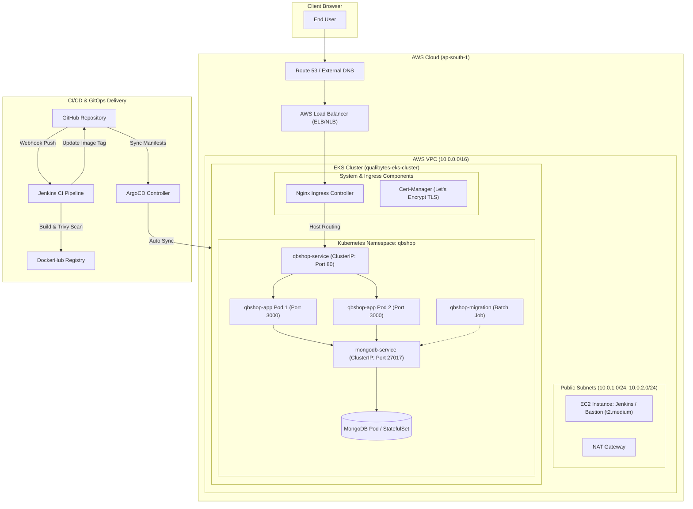

# 🛍️ QualiBytesShop - Commercial E-Commerce Platform

[](https://nextjs.org/)
[](https://www.typescriptlang.org/)
[](https://www.mongodb.com/)
[](https://www.docker.com/)
[](https://kubernetes.io/)
[](https://www.terraform.io/)
[](https://aws.amazon.com/)
[](https://www.jenkins.io/)
[](https://argo-cd.readthedocs.io/)
[](LICENSE)

QualiBytesShop is a modern, enterprise-ready full-stack e-commerce web platform built with **Next.js 14 App Router**, **TypeScript**, and **MongoDB**. The platform provides a multi-department storefront (gadgets, groceries, bakery, clothing, makeup, bags, furniture, books, and medicine), persistent shopping cart management, server-side verified checkout, and an automated end-to-end cloud infrastructure on **Amazon Web Services (AWS)** using **Terraform**, **Kubernetes (EKS)**, **Docker**, **Jenkins**, and **ArgoCD**.

---

## 📑 Table of Contents
1. [Core Features](#-core-features)
2. [DevOps Toolchain & Stack](#-devops-toolchain--stack)
3. [Cloud & Deployment Architecture](#-cloud--deployment-architecture)
4. [Prerequisites](#-prerequisites)
5. [Track 1: Local Development & Docker Setup](#-track-1-local-development--docker-setup)
6. [Track 2: Production AWS Deployment Guide](#-track-2-production-aws-deployment-guide)
   - [Step 1: Configure AWS CLI & Permissions](#step-1-configure-aws-cli--permissions)
   - [Step 2: Generate SSH Key Pair for EC2](#step-2-generate-ssh-key-pair-for-ec2)
   - [Step 3: Provision AWS Infrastructure via Terraform](#step-3-provision-aws-infrastructure-via-terraform)
   - [Step 4: Connect kubectl to AWS EKS Cluster](#step-4-connect-kubectl-to-aws-eks-cluster)
   - [Step 5: Deploy Ingress-Nginx Controller](#step-5-deploy-ingress-nginx-controller)
   - [Step 6: Deploy Cert-Manager for Automated SSL/TLS](#step-6-deploy-cert-manager-for-automated-ssltls)
   - [Step 7: Deploy MongoDB Database & Service](#step-7-deploy-mongodb-database--service)
   - [Step 8: Build & Push Docker Images](#step-8-build--push-docker-images)
   - [Step 9: Seed Database via Kubernetes Migration Job](#step-9-seed-database-via-kubernetes-migration-job)
   - [Step 10: Deploy Next.js Web Application](#step-10-deploy-nextjs-web-application)
   - [Step 11: Configure Ingress Rules & DNS Mapping](#step-11-configure-ingress-rules--dns-mapping)
   - [Step 12: CI/CD Pipeline Setup (Jenkins & ArgoCD)](#step-12-cicd-pipeline-setup-jenkins--argocd)
7. [Accessing & Verifying the Application](#-accessing--verifying-the-application)
8. [Tear Down & Zero-Cost AWS Clean-Up Guide](#-tear-down--zero-cost-aws-clean-up-guide)
9. [Troubleshooting & SRE Runbook](#-troubleshooting--sre-runbook)

---

## ✨ Core Features
- 🛒 **Multi-Shop Catalog Taxonomy**: 9 distinct retail categories with customized UI layouts and cards.
- 🔍 **Real-Time Search & Aggregation**: Escaped regex querying and weighted bestseller ranking algorithms.
- 🛍️ **Persistent Shopping Cart**: Redux Toolkit state synchronized across browser tabs with local storage.
- 💳 **Server-Verified Checkout**: Server-side recalculated line-item pricing and Cash-on-Delivery (COD) flows.
- 🔐 **JWT-Based Authentication**: Encrypted session cookies (`jose` / `jsonwebtoken`) and role-based middleware guards (`/checkout`, `/profile`, `/admin`).
- 🩺 **Health Probes**: Dedicated `/api/health/live` and `/api/health/ready` endpoints for Kubernetes cluster lifecycle management.
- 📱 **Modern Responsive UI**: Mobile-first styling with Tailwind CSS, Radix UI primitives, and dark/light mode themes.

---

## 🛠️ DevOps Toolchain & Stack

| Category | Tool / Technology | Version / Spec | Purpose |
|---|---|---|---|
| **Cloud Provider** | **Amazon Web Services (AWS)** | Region `ap-south-1` | Cloud infrastructure hosting VPC, EKS, EC2, and Load Balancers. |
| **Infrastructure as Code** | **HashiCorp Terraform** | `>= 1.2.0, < 2.0.0` | Declarative provisioning of AWS VPC, EKS Cluster, Node Groups, and EC2 Bastion. |
| **Containerization** | **Docker** | Engine 24+ | Multi-stage Alpine builds generating minimal standalone Node.js production images. |
| **Container Security** | **Aqua Security Trivy** | Latest | Automated CVE scanning of Docker images during CI pipeline stages. |
| **Container Orchestration** | **Kubernetes (AWS EKS)** | `v1.28+` | Container scheduling, self-healing, rolling updates, and service discovery. |
| **Package Management** | **Helm** | `v3+` | Kubernetes package management for Nginx Ingress, Cert-Manager, and monitoring. |
| **Ingress Controller** | **Nginx Ingress** | Latest | Reverse proxy and HTTP/HTTPS routing via AWS Network/Application Load Balancer. |
| **SSL / TLS Automation** | **Cert-Manager** | `v1.12+` | Automated issuance and renewal of TLS certificates via Let's Encrypt ACME. |
| **Continuous Integration** | **Jenkins** | LTS (Java 21) | Automated pipeline for Docker build, Trivy scan, DockerHub push, and GitOps trigger. |
| **GitOps Continuous Delivery**| **ArgoCD** | Latest | Declarative, automated synchronization of Kubernetes manifests from Git to EKS. |
| **Database** | **MongoDB** | `8.1.1` / `7.0` | NoSQL document storage with Mongoose connection pooling and automated seeding. |
| **Monitoring & Metrics** | **Prometheus & Grafana** | Optional | Observability, pod telemetry, error-rate tracking, and cluster dashboards. |

---

## 🏗️ Cloud & Deployment Architecture



---

## 📋 Prerequisites

Before starting, install the following tools on your machine (Local Windows, WSL2, or Linux):

- **AWS CLI v2**: `aws --version` ([Install Guide](https://docs.aws.amazon.com/cli/latest/userguide/getting-started-install.html))
- **Terraform** (`>= 1.2.0`): `terraform -version` ([Install Guide](https://developer.hashicorp.com/terraform/install))
- **kubectl**: `kubectl version --client` ([Install Guide](https://kubernetes.io/docs/tasks/tools/))
- **Helm v3**: `helm version` ([Install Guide](https://helm.sh/docs/intro/install/))
- **Docker & Docker Compose**: `docker --version` ([Install Guide](https://docs.docker.com/get-docker/))
- **Node.js** (`18.x` LTS) & **npm**: `node -v`

---

## 💻 Track 1: Local Development & Docker Setup

Get the full application and database running locally in under 3 minutes.

### 1. Open or Clone the Repository
* **If cloning freshly:**
  ```bash
  git clone https://github.com/Dev664/Commercial-QB-Website.git "Commercial QB Website"
  cd "Commercial QB Website"
  ```
* **Or navigate to the project directory:**
  * **Windows (PowerShell in VS Code):**
    ```powershell
    cd "C:\Users\debdi\OneDrive\Desktop\CLASS NOTE\PROJECTS\Commercial QB Website"
    ```
  * **Linux / WSL (OL8):**
    ```bash
    cd "/mnt/c/Users/debdi/OneDrive/Desktop/CLASS NOTE/PROJECTS/Commercial QB Website"
    ```

### 2. Configure Local Environment
```bash
# Copy default environment variables
cp .env .env.local
```

### 3. Run the Full Stack via Docker Compose
```bash
# Builds images, seeds MongoDB catalog, and starts Next.js
docker compose up --build -d
```

### 4. Verify Local Execution
```bash
# Check container status
docker compose ps

# View migration logs (verifies product seeding)
docker logs qbs-migration

# View application logs
docker logs -f qbs-app
```
Open your browser and navigate to: **`http://localhost:3000`**

To stop the local environment:
```bash
docker compose down -v
```

---

## 🚀 Track 2: Production AWS Deployment Guide

Follow these steps sequentially to deploy the platform to AWS.

### Step 1: Configure AWS CLI & Permissions
* **Where to run**: Local terminal / WSL
* **Action**: Ensure your IAM user has Administrator/EKS permissions, then authenticate:
```bash
aws configure
# Enter your AWS Access Key ID, Secret Access Key, Region (ap-south-1), and Output (json)

# Verify identity
aws sts get-caller-identity
```

---

### Step 2: Generate SSH Key Pair for EC2
* **Where to run**: Inside the `terraform/` directory
* **Action**: Generate the SSH key required by `ec2.tf`:
```bash
cd terraform

# Generate SSH key pair
ssh-keygen -t rsa -b 4096 -f qualibytes-key -N ""

# Ensure secure file permissions (Linux/WSL)
chmod 400 qualibytes-key
```

---

### Step 3: Provision AWS Infrastructure via Terraform
* **Where to run**: Inside the `terraform/` directory
* **Action**: Initialize Terraform, inspect the execution plan, and provision the VPC, EKS cluster, node groups, and EC2 Bastion host:
```bash
# 1. Initialize Terraform plugins and modules
terraform init

# 2. Review the infrastructure plan
terraform plan

# 3. Provision AWS infrastructure (~15-20 minutes for EKS)
terraform apply -auto-approve

# 4. View provisioned outputs
terraform output
```

---

### Step 4: Connect kubectl to AWS EKS Cluster
* **Where to run**: Local terminal / WSL
* **Action**: Configure your local `kubeconfig` to target the newly provisioned EKS cluster:
```bash
# Update kubeconfig
aws eks --region ap-south-1 update-kubeconfig --name qualibytes-eks-cluster

# Verify worker nodes are Ready
kubectl get nodes -o wide
```

---

### Step 5: Deploy Ingress-Nginx Controller
* **Where to run**: Local terminal / WSL
* **Action**: Install the Ingress-Nginx controller via Helm to create an internet-facing AWS Load Balancer:
```bash
# 1. Add Nginx Ingress Helm repository
helm repo add ingress-nginx https://kubernetes.github.io/ingress-nginx
helm repo update

# 2. Install Ingress Controller
helm install nginx-ingress ingress-nginx/ingress-nginx \
  --namespace ingress-nginx \
  --create-namespace \
  --set controller.service.type=LoadBalancer

# 3. Wait for AWS Load Balancer hostname allocation
kubectl get svc -n ingress-nginx -w
```
> **Note**: Note the external hostname (e.g. `k8s-ingressn-xxx.elb.ap-south-1.amazonaws.com`).

---

### Step 6: Deploy Cert-Manager for Automated SSL/TLS
* **Where to run**: Project root directory
* **Action**: Install Cert-Manager and apply the Let's Encrypt ClusterIssuer:
```bash
# 1. Add Jetstack Helm repo
helm repo add jetstack https://charts.jetstack.io
helm repo update

# 2. Install Cert-Manager with CRDs
helm install cert-manager jetstack/cert-manager \
  --namespace cert-manager \
  --create-namespace \
  --version v1.12.0 \
  --set installCRDs=true

# 3. Verify Cert-Manager pods are running
kubectl get pods -n cert-manager

# 4. Apply Let's Encrypt ClusterIssuer
kubectl apply -f kubernetes/00-cluster-issuer.yml
```

---

### Step 7: Deploy MongoDB Database & Service
* **Where to run**: Project root directory
* **Action**: Create the `qbshop` namespace and deploy MongoDB:
```bash
# 1. Create application namespace
kubectl apply -f kubernetes/01-namespace.yaml

# 2. Deploy MongoDB and internal ClusterIP service
kubectl apply -f kubernetes/02-mongodb.yaml

# 3. Verify MongoDB pod is running
kubectl get pods -n qbshop -l app=mongodb
```

---

### Step 8: Build & Push Docker Images
* **Where to run**: Project root directory
* **Action**: Build and push the main application and migration images to your container registry (DockerHub or AWS ECR):
```bash
# Set your registry username
export REGISTRY_USER="doc201"  # DockerHub username

# Login to DockerHub
docker login

# 1. Build and push Next.js App image
docker build -t $REGISTRY_USER/qbshop-app:latest -f Dockerfile .
docker push $REGISTRY_USER/qbshop-app:latest

# 2. Build and push Database Migration image
docker build -t $REGISTRY_USER/qbshop-migration:latest -f scripts/Dockerfile.migration .
docker push $REGISTRY_USER/qbshop-migration:latest
```

---

### Step 9: Seed Database via Kubernetes Migration Job
* **Where to run**: Project root directory
* **Action**: Run the batch Job to seed the catalog dataset into the in-cluster MongoDB:
```bash
# 1. Apply ConfigMap containing database URI and settings
kubectl apply -f kubernetes/04-configmap.yaml

# 2. Run the database migration job
kubectl apply -f kubernetes/07-migration-job.yaml

# 3. Follow logs until completion
kubectl logs -f job/qbshop-migration-job -n qbshop
```
*Expected log output*: `Migrated 100+ products` and `Migration completed successfully`.

---

### Step 10: Deploy Next.js Web Application
* **Where to run**: Project root directory
* **Action**: Deploy the web application deployment and ClusterIP service:
```bash
# 1. Deploy Next.js App Deployment (configured with health probes)
kubectl apply -f kubernetes/05-app-deployment.yaml

# 2. Expose application via ClusterIP service on port 80
kubectl apply -f kubernetes/06-app-service.yaml

# 3. Verify pods and service are healthy
kubectl get pods,svc -n qbshop
```

---

### Step 11: Configure Ingress Rules & DNS Mapping
* **Where to run**: Project root directory
* **Action**: Map your domain name to the AWS Load Balancer and apply Ingress routing:

1. **Get the AWS Load Balancer external hostname**:
   ```bash
   kubectl get svc nginx-ingress-ingress-nginx-controller -n ingress-nginx -o jsonpath='{.status.loadBalancer.ingress[0].hostname}'
   echo ""
   ```

2. **Update DNS Record**:
   In your domain registrar (Route 53, GoDaddy, Namecheap, Cloudflare), create a **CNAME** record:
   - **Host / Name**: `qbshop` (or `@` / your subdomain)
   - **Points to / Target**: `<AWS_LOAD_BALANCER_HOSTNAME>`
   - **TTL**: 300 seconds

3. **Apply Ingress Manifest**:
   Update the host in `kubernetes/10-ingress.yaml` to match your domain, then apply:
   ```bash
   kubectl apply -f kubernetes/10-ingress.yaml

   # Check Ingress status and certificate provisioning
   kubectl get ingress -n qbshop
   kubectl get certificate -n qbshop
   ```

---

### Step 12: CI/CD Pipeline Setup (Jenkins & ArgoCD)

#### 1. Access Jenkins on the EC2 Instance
```bash
# Get the Public IP of your EC2 instance from Terraform output
cd terraform && terraform output public_ip

# Open in browser: http://<EC2_PUBLIC_IP>:8080

# Retrieve initial administrator password
ssh -i qualibytes-key ubuntu@<EC2_PUBLIC_IP> "sudo cat /var/lib/jenkins/secrets/initialAdminPassword"
```
Install the recommended plugins plus **Docker Pipeline** and **Pipeline Utility Steps**.

#### 2. Configure Credentials in Jenkins
Navigate to: **Manage Jenkins → Credentials → System → Global credentials → Add Credentials**:
- **GitHub Credentials**: Kind: *Username with password*, ID: `github-credentials`
- **DockerHub Credentials**: Kind: *Username with password*, ID: `docker-hub-credentials`

#### 3. Create Pipeline Job
1. Click **New Item** → Name: `qbshop` → Select **Pipeline** → Click **OK**.
2. Under **Build Triggers**, select **GitHub hook trigger for GITScm polling**.
3. Under **Pipeline**:
   - **Definition**: *Pipeline script from SCM*
   - **SCM**: *Git*
   - **Repository URL**: `https://github.com/Dev664/Commercial-QB-Website.git`
   - **Branch**: `main` (or `dev`)
   - **Script Path**: `Jenkinsfile`
4. Click **Save** and trigger **Build Now**.

#### 4. GitOps Delivery with ArgoCD
```bash
# 1. Install ArgoCD on the EKS cluster
kubectl create namespace argocd
kubectl apply -n argocd -f https://raw.githubusercontent.com/argoproj/argo-cd/stable/manifests/install.yaml

# 2. Wait for pods to become ready
kubectl wait --for=condition=available deployment -l app.kubernetes.io/name=argocd-server -n argocd --timeout=300s

# 3. Retrieve admin initial password
kubectl -n argocd get secret argocd-initial-admin-secret -o jsonpath="{.data.password}" | base64 -d; echo

# 4. Port-forward ArgoCD GUI to access locally
kubectl port-forward svc/argocd-server -n argocd 8085:443 &
```
Open **`https://localhost:8085`** in your browser (Username: `admin`). Create an application pointing to your repository's `kubernetes/` folder with **Automatic Sync** enabled.

---

## 🌐 Accessing & Verifying the Application

### 1. Production Custom Domain (HTTPS)
Navigate to your configured domain:
👉 **`https://qbshop.yourdomain.com`**

### 2. Instant Local Port-Forward (No Domain / Testing Mode)
If you do not have a custom domain or want to verify before DNS propagation:
```bash
kubectl port-forward svc/qbshop-service 8080:80 -n qbshop
```
Navigate to: **`http://localhost:8080`**

### 3. Verification Checklist
- [x] **Storefront**: Verify that hero banners, category grids, and product images load correctly.
- [x] **Health Check Endpoints**:
  - Live probe: `curl http://localhost:8080/api/health/live` → `{"status":"live"}`
  - Ready probe: `curl http://localhost:8080/api/health/ready` → `{"status":"ready","database":"connected"}`
- [x] **Authentication**: Log in with pre-seeded demo user (`demo@gmail.com` / `test1234`).
- [x] **Order Flow**: Add an item to the cart, navigate to checkout, enter addresses, and place a Cash-on-Delivery order.

---

## 🧹 Tear Down & Zero-Cost AWS Clean-Up Guide

> [!CAUTION]
> **Strict Teardown Order**:
> Always delete the Kubernetes Ingress and Load Balancers **BEFORE** executing `terraform destroy`. If you destroy Terraform first, AWS will refuse to delete subnets and VPCs because the dynamic Load Balancer is still attached to them, causing Terraform to hang and leave billable resources running.

Execute the clean-up steps in this exact order:

### 1. Remove Ingress and Ingress Controller (Deletes AWS Load Balancer)
```bash
# 1. Delete Ingress resource
kubectl delete ingress qbshop-ingress -n qbshop --ignore-not-found=true

# 2. Uninstall Nginx Ingress via Helm (triggers AWS ELB deletion)
helm uninstall nginx-ingress -n ingress-nginx

# 3. Delete ingress namespace
kubectl delete namespace ingress-nginx --ignore-not-found=true
```

### 2. Delete Application and Cert-Manager Namespaces
```bash
# Uninstall cert-manager
helm uninstall cert-manager -n cert-manager
kubectl delete namespace cert-manager --ignore-not-found=true

# Delete application namespace (terminates pods, services, jobs)
kubectl delete namespace qbshop --ignore-not-found=true

# Wait 60-90 seconds for AWS to finish deleting the external ELB
```

### 3. Verify AWS Load Balancers Are Terminated
```bash
aws elb describe-load-balancers --region ap-south-1 --query "LoadBalancerDescriptions[*].LoadBalancerName" --output table
aws elbv2 describe-load-balancers --region ap-south-1 --query "LoadBalancers[*].LoadBalancerName" --output table
```
*Ensure both tables return empty.*

### 4. Destroy Infrastructure via Terraform
```bash
cd terraform

# Destroys EKS cluster, node groups, EC2 instance, NAT Gateways, and VPC
terraform destroy -auto-approve
```

### 5. Run Zero-Cost Audit Commands
Run these commands to verify no orphaned, billable resources remain:
```bash
# 1. Confirm 0 NAT Gateways
aws ec2 describe-nat-gateways --region ap-south-1 --filter "Name=state,Values=available,pending" --query "NatGateways[*].NatGatewayId" --output table

# 2. Confirm 0 Unattached Elastic IPs (charged if unused)
aws ec2 describe-addresses --region ap-south-1 --query "Addresses[*].{IP:PublicIp,AllocationId:AllocationId,Instance:InstanceId}" --output table

# 3. Confirm 0 Orphaned EBS Volumes
aws ec2 describe-volumes --region ap-south-1 --filters Name=status,Values=available --query "Volumes[*].{VolumeId:VolumeId,Size:Size}" --output table

# 4. Confirm 0 Running EC2 Instances
aws ec2 describe-instances --region ap-south-1 --filters "Name=instance-state-name,Values=running,pending" --query "Reservations[*].Instances[*].{ID:InstanceId,State:State.Name}" --output table
```

---

## 🔧 Troubleshooting & SRE Runbook

| Problem | Root Cause | Remediation Command |
|---|---|---|
| **Pod CrashLoopBackOff** | Container out of memory or startup crash | `kubectl logs -n qbshop deploy/qbshop-app --previous --tail=100`<br>`kubectl describe pod -n qbshop -l app=qbshop-app` |
| **Readiness Probe Failing (`503`)** | MongoDB connection failure or unready state | `kubectl get pods -n qbshop -l app=mongodb`<br>`kubectl exec -it deploy/qbshop-app -n qbshop -- nc -zv mongodb-service 27017` |
| **Let's Encrypt Certificate Pending** | DNS record mismatch or HTTP-01 challenge issue | `kubectl describe certificate qbshop-tls -n qbshop`<br>`kubectl describe challenge -n qbshop`<br>`kubectl logs -n cert-manager -l app=cert-manager` |
| **Terraform Destroy Hangs on VPC** | AWS ELB created by Kubernetes still exists | Delete Ingress and Helm release manually, wait 2 minutes, then rerun `terraform destroy`. |
| **ImagePullBackOff** | Docker image name or tag incorrect / private repo auth missing | Check `image:` in `kubernetes/05-app-deployment.yaml` and verify DockerHub repo accessibility. |

---

## 📄 License
This project is licensed under the MIT License - see the [LICENSE](LICENSE) file for details.
